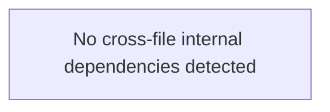

# PROJECT MAP & ARCHITECTURE TOPOLOGY

> Autogenerated via `generate_codemap.py`. Subagents MUST read this map first to identify relevant code slices and avoid full repository scans.

## 1. Project Overview & Tech Stack Fingerprint
- **Architecture Style:** Modular Monolith
- **Total Monitored Files:** 4 files across 837 lines of code
- **Languages:** Markdown (4 files, 837 LOC, 100.0%)
- **Frameworks & Core Runtimes:** Standard platform libraries
- **Tooling & Infrastructure:** Standard tooling

## 2. File Topology & Responsibilities Registry

### General / Core (4 files)
| File Path | LOC | Blast Radius | Core Symbols & Responsibilities |
| :--- | :--- | :--- | :--- |
| `Script/script.md` | 300 | 0 | Module declarations |
| `sEMG/THIET_KE_AFE_PA2.md` | 197 | 0 | Module declarations |
| `cac_phuong_an_thiet_ke_semg.md` | 170 | 0 | Module declarations |
| `Script/cac_phuong_an_thiet_ke_semg.md` | 170 | 0 | Module declarations |

## 3. Cross-File Dependency & Call Flow Graph (Data Flow)
High-level architectural call and data direction:
```text
   [Entry Points / CLI / App]
               │
               ▼
        [API / Routes]
               │
               ▼
      [Services / Logic]
               │
               ▼
    [Models / Database / Store]
```



## 4. Quick-Lookup Action Matrix (Blast Radius & Impact Analysis)
When planning modifications, check inbound dependents to assess regression blast radius:

No high blast-radius files detected. Modules are decoupled or standalone.

## 5. Key Invariants & Boundary Guards
1. **Layer Dependency Direction:** Models and Schemas must remain independent of API controllers and UI components.
2. **Blast Radius Check:** Modifying any file marked `HIGH` or `CRITICAL` risk requires running its dependent modules' tests.
3. **Context Diet Rule:** Do not read full files when making targeted changes. Inspect only the relevant function or symbols listed above.
4. **System Laws Reference:** Always cross-reference `INVARIANTS.md` and `session-state.md` before applying architectural refactors.
